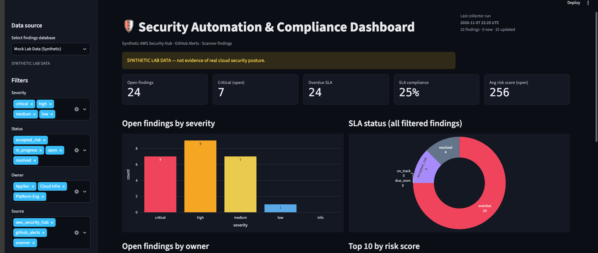
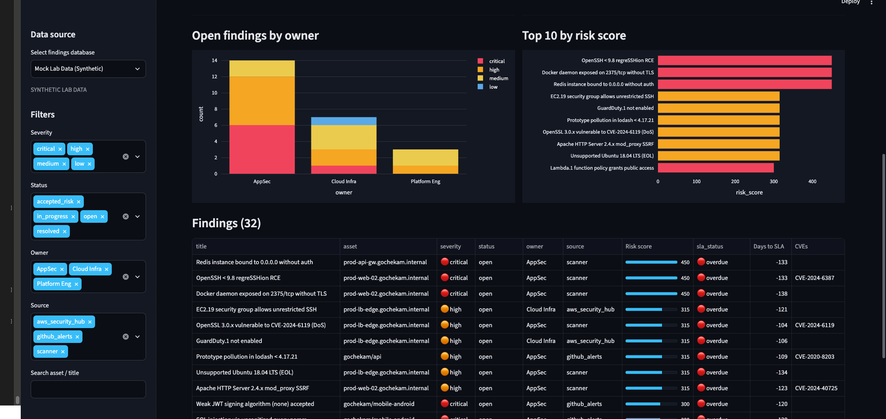
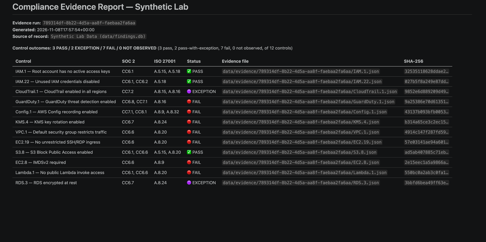
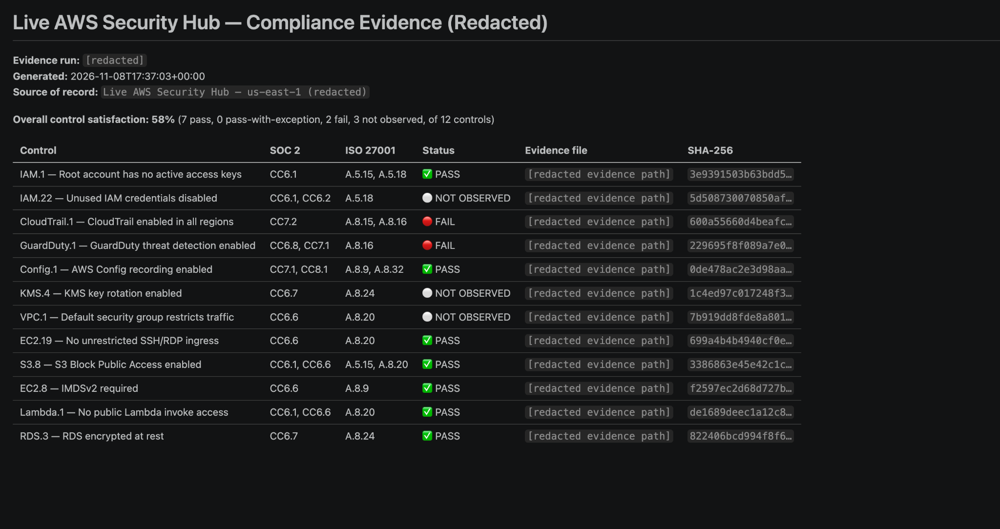

# Security Automation & Compliance Dashboard

A single pipeline that pulls vulnerability and misconfiguration findings from
three sources, scores them by actual risk (not just severity), tracks them
against SLA, visualizes the result live, and generates reviewable
compliance evidence from the same data — instead of four disconnected demos.

## Architecture

The system uses live AWS Security Hub ingestion alongside synthetic
GitHub and vulnerability-scanner sources. Live and mock findings are
stored in separate SQLite databases.

[View the system architecture diagram](docs/architecture.md)

The screenshots and example reports are available in the
[Project Demonstration](#project-demonstration) section.

## Why this exists

Most portfolio security projects are a dashboard *or* a script *or* a policy
doc. This is one pipeline where the policy document, the pipeline, and the
evidence report all reference the same 12 AWS Security Hub controls — change
a remediation SLA in one place ([`collector/risk.py`](collector/risk.py)) and
the baseline document, the dashboard, and the evidence report are all
describing the same policy, not three independently-maintained ones.

Mock collection uses synthetic findings without AWS credentials. AWS Security Hub supports live ingestion through a dedicated IAM identity. GitHub Alerts and vulnerability scanner integrations remain synthetic. Live and mock findings are stored separately.

## Quickstart

```bash
pip install -r requirements.txt

python collect.py --source mock --csv  # synthetic lab findings
python evidence.py --source mock  # generate synthetic compliance evidence
python -m streamlit run app.py  # select mock or live in the sidebar
```

For authorized live AWS collection, configure a read-only IAM identity,
then run:

    python collect.py --source aws-security-hub --aws-profile security-lab --aws-region us-east-1
    python evidence.py --source live

The commands use separate live and synthetic SQLite databases.


Re-run `collect.py` any time — it's idempotent. Findings are upserted by ID,
so an unchanged finding keeps its original `first_seen` timestamp and its SLA
clock doesn't reset just because the collector ran again. This is meant to
run on a schedule (cron, GitHub Actions) the same way a real collector would.

## What's in here

| Path | What it is |
|---|---|
| `collect.py` | Orchestrates all 3 sources → normalizes → upserts into SQLite |
| `collector/models.py` | Shared `Finding` schema + severity normalization |
| `collector/sources.py` | One adapter per source (AWS Security Hub, GitHub, scanner) |
| `collector/risk.py` | SLA policy + risk score formula (documented, not a black box) |
| `collector/db.py` | Schema, idempotent upsert, collector-run audit trail |
| `app.py` | Streamlit dashboard, reads live from `data/findings.db` |
| `evidence.py` | Compliance evidence automation — the Drata-style step |
| `compliance/control_catalog.py` | Maps each control to SOC 2 / ISO 27001 references |
| `AWS_Security_Baseline.docx` | The policy document the pipeline actually enforces |
| `mock_data/generate_mock_data.py` | Regenerates the 3 mock vendor payloads (seeded) |
| `jira_export.py` | Exports overdue/due-soon findings as Jira REST API v3 payloads |

## The risk score isn't just severity

A CVSS score alone doesn't tell you what to fix first. This pipeline computes:

```
risk_score = severity_weight × asset_criticality_multiplier × SLA_age_multiplier
```

An aging critical finding on an internet-facing asset outranks a
freshly-discovered critical on a dev sandbox — and a finding that's sat open
for 2x its SLA window outranks one still within it. The full formula and
constants are in [`collector/risk.py`](collector/risk.py), written to be
read and argued with, not just executed.

## The evidence step proves something, not just logs it

`evidence.py` doesn't re-scan anything — it evaluates the *same* database the
dashboard reads, against a control catalog mapped to SOC 2 and ISO 27001, and
writes:

- one JSON evidence export per control (the raw matching findings)
- a SHA-256 hash in the manifest for integrity comparison; the manifest
  itself is not independently signed or tamper-proof
- a status per control: `PASS`, `PASS_WITH_EXCEPTION` (mock exception status, not independently verified approval), `FAIL`, or `NOT_OBSERVED` (the control never triggered a
  finding — which is *not* the same as passing, and the report says so)
- a human-readable `Compliance_Evidence_Report.md` an auditor could actually read

Run `python evidence.py --source mock` or `python evidence.py --source live` after collection. Reports are stored separately by evidence mode.

## Honest limitations

- AWS Security Hub CSPM ingestion is live. GitHub Alerts and vulnerability scanner integrations remain synthetic.
- Live evidence uses Security Hub control IDs, AWS compliance statuses, and a 24-hour collection freshness check.
- Findings absent from a later collection remain in historical storage; disappearance is not proof of remediation.
- A Security Hub PASSED assessment does not independently establish SOC 2 or ISO 27001 compliance.
- The SHA-256 evidence manifest supports file-integrity comparison but is not independently signed or tamper-proof.
- SUPPRESSED findings remain subject to risk aging and SLA tracking; suppression does not constitute approved risk acceptance.


## Stack

Python · SQLite · Streamlit · Plotly · pandas · docx (document generation)

## Live AWS Security Hub Integration

This project supports two separate data sources:

| Mode | Database | Description |
|---|---|---|
| Mock Lab Data | `data/findings.db` | Synthetic security findings |
| Live AWS Security Hub | `data/securityhub_live.db` | Findings collected from AWS |

### Architecture

AWS Security Hub CSPM → Boto3 GetFindings API → Finding normalization → Risk scoring and SLA tracking → SQLite → Streamlit dashboard.

### Requirements

- Python 3.12 or later, using a supported version
- AWS CLI v2
- Boto3 with AWS CRT support
- AWS Security Hub CSPM enabled in the selected Region
- An authorized IAM identity with `securityhub:GetFindings`

### Authentication

Use a dedicated IAM identity with least-privilege permissions.

    aws login --profile security-lab --region us-east-1
    aws sts get-caller-identity --profile security-lab

The profile name is illustrative.

### Live AWS collection

    python collect.py --source aws-security-hub --aws-profile security-lab --aws-region us-east-1 --csv

### Mock collection

    python mock_data/generate_mock_data.py
    python collect.py --source mock --csv

### Launch dashboard

    python -m streamlit run app.py --server.address 127.0.0.1 --server.port 8502

Use the sidebar selector to switch between synthetic and live findings.

### Security controls

- Live and mock findings use separate SQLite databases.
- Failed AWS requests do not silently fall back to synthetic findings.
- Successful collection runs are recorded for auditability.
- AWS credentials, live SQLite data, and CSV exports are excluded from Git.
- Suppressed findings are not automatically considered accepted risk.
- The dashboard's SLA calculation is an internal metric, not an AWS certification.
- An empty findings response does not establish compliance.

### Validation

On November 8, 2026, a validated live AWS Security Hub collection in us-east-1 returned 392 findings; all 392 were tagged to the same collection run. The 12-control evidence report returned 7 PASS, 2 FAIL, and 3 NOT_OBSERVED. These are historical validation results.

Automated tests use synthetic AWS API responses and temporary databases. They cover pagination, API errors, finding normalization, workflow statuses, SLA calculations, risk scoring, and database isolation.

The GitHub Alerts and vulnerability-scanner adapters remain mock-only. Cross-Region aggregation, production scheduling, and formal risk-acceptance approval verification are not implemented.

AWS Security Hub CSPM and AWS Config can incur charges. Review AWS Budgets and disable unused services after testing.

## Continuous Integration

GitHub Actions runs the Python unit tests on pull requests targeting `main` and pushes to `main`.

Run locally:

    python -m unittest discover -s tests -q

For mock evidence:

    python evidence.py --source mock

For live AWS evidence after collecting findings:

    python evidence.py --source live


## Project Demonstration

This project demonstrates automated security findings collection, risk prioritization, SLA tracking, and compliance evidence generation.

### Architecture

[View the security architecture diagram](docs/architecture.md)

AWS Security Hub CSPM provides live findings. GitHub Alerts and vulnerability-scanner integrations use synthetic data.

### Dashboard Overview



*The dashboard screenshot uses synthetic lab data.*

### Risk Prioritization



*Risk scoring, SLA monitoring, severity distribution, and finding ownership using synthetic findings.*

### Compliance Evidence



*Example synthetic evidence report mapping 12 AWS controls to SOC 2 and ISO 27001 references. Exception statuses do not independently verify formal risk acceptance.*

### Verified Live AWS Integration

On November 8, 2026, a live AWS Security Hub collection in `us-east-1` returned 392 findings. All 392 were associated with the latest successful collection run.

The live evidence report evaluated 12 catalog controls:

- 7 PASS
- 2 FAIL
- 3 NOT_OBSERVED

These are historical AWS assessment results, not certification or proof of organization-wide compliance.

### Automated Validation

The project includes 38 Python tests and a GitHub Actions workflow that validates pull requests targeting `main`.


### Verified Live AWS Compliance Evidence



*Redacted evidence from an authorized AWS Security Hub collection in us-east-1 on November 8, 2026. The 12-control evaluation recorded 7 PASS, 2 FAIL, and 3 NOT_OBSERVED. Results reflect the recorded AWS assessments, not a formal SOC 2 or ISO 27001 audit.*
