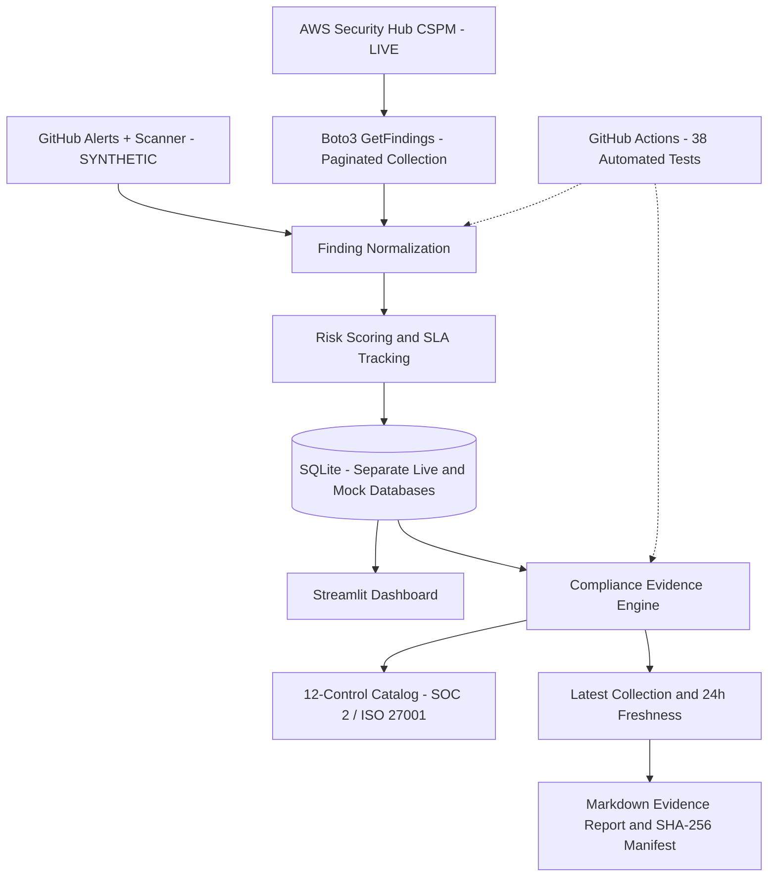

# Security Automation & Compliance Dashboard — Architecture

## Security design

- Live AWS Security Hub collection uses a dedicated least-privilege IAM user.
- Live and synthetic findings are stored in separate SQLite databases.
- Compliance evidence uses structured AWS Security Hub control identifiers.
- Missing findings retain their historical records rather than being automatically resolved.
- SHA-256 manifests provide integrity comparison, not independently signed evidence.
- GitHub Alerts and vulnerability scanner integrations remain synthetic.
